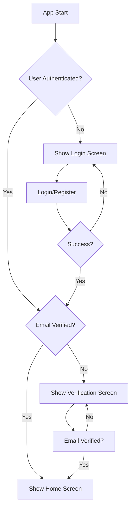

# ShebaGreen Technical Documentation

## Overview

ShebaGreen is a gamified mobile application that engages Ethiopian youth in environmental cleanup activities through EcoToken rewards. This documentation covers the authentication system implementation, which serves as the foundation for user management and security.

## Architecture

### High-Level Architecture

```
┌─────────────────┐    ┌─────────────────┐    ┌─────────────────┐
│   Presentation  │    │     Business    │    │      Data       │
│     Layer       │◄──►│     Logic       │◄──►│     Layer       │
│                 │    │     Layer       │    │                 │
│ - UI Screens    │    │ - Controllers   │    │ - Repositories  │
│ - Widgets       │    │ - State Mgmt    │    │ - API Calls     │
│ - Navigation    │    │ - Validation    │    │ - Local Storage │
└─────────────────┘    └─────────────────┘    └─────────────────┘
                                │
                                ▼
                    ┌─────────────────┐
                    │    External     │
                    │    Services     │
                    │                 │
                    │ - Firebase Auth │
                    │ - Google OAuth  │
                    │ - Cloud Storage │
                    └─────────────────┘
```

### Technology Stack

- **Framework**: Flutter 3.8.1+
- **State Management**: Riverpod 2.6.1
- **Navigation**: GoRouter 14.6.2
- **Backend Services**: Firebase Authentication 5.7.0
- **OAuth Provider**: Google Sign-In 6.2.1
- **Design System**: Material Design 3 with custom ShebaGreen theme

## Authentication System

### Authentication Flow



### Authentication States

The application uses a comprehensive state management system with the following states:

1. **Initial**: App just started, checking authentication status
2. **Loading**: Processing authentication operation
3. **Authenticated**: User is signed in with verified email
4. **Unauthenticated**: User is not signed in
5. **Unverified**: User is signed in but email not verified
6. **Error**: Authentication operation failed

### Security Considerations

#### Password Requirements
- Minimum 6 characters
- Must contain both letters and numbers
- Validated on both client and server side

#### Email Verification
- Mandatory for all new accounts
- Automatic verification email sending
- Real-time verification status checking
- Prevents access to protected features until verified

#### Session Management
- Firebase handles session tokens automatically
- Tokens refresh automatically when needed
- Secure logout from all devices
- Protection against session hijacking

#### Error Handling
- User-friendly error messages
- No sensitive information exposed in error messages
- Proper fallback for network issues
- Rate limiting protection for authentication attempts

## Implementation Details

### Project Structure

```
lib/
├── core/
│   ├── providers/          # Global Riverpod providers
│   ├── router.dart         # GoRouter configuration
│   └── theme/
│       └── app_theme.dart  # ShebaGreen theme configuration
├── features/
│   ├── auth/
│   │   ├── data/
│   │   │   └── auth_repository.dart    # Firebase Auth operations
│   │   └── presentation/
│   │       ├── auth_controller.dart    # State management
│   │       ├── login_screen.dart       # Login UI
│   │       ├── register_screen.dart    # Registration UI
│   │       ├── forgot_password_screen.dart  # Password reset
│   │       └── verify_email_screen.dart     # Email verification
│   └── home/
│       └── home_screen.dart           # Main app dashboard
├── main.dart                          # App entry point
└── firebase_options.dart             # Firebase configuration
```

### Key Components

#### AuthRepository (Data Layer)
- Handles all Firebase Authentication operations
- Provides clean interface for authentication methods
- Abstracts Firebase implementation details
- Includes comprehensive error handling

**Methods**:
- `signUp()`: Creates new user account with email verification
- `signInWithEmailAndPassword()`: Standard email/password login
- `signInWithGoogle()`: Google OAuth integration
- `sendPasswordResetEmail()`: Password reset functionality
- `sendEmailVerification()`: Email verification management
- `signOut()`: Secure logout from all sessions

#### AuthController (Business Logic Layer)
- Manages authentication state using Riverpod StateNotifier
- Provides reactive state updates
- Handles authentication flow logic
- Converts Firebase errors to user-friendly messages

**Features**:
- Real-time auth state monitoring
- Automatic state transitions
- Error message localization
- Loading state management

#### Router Configuration (Navigation Layer)
- GoRouter-based navigation with authentication guards
- Automatic redirection based on auth state
- Protected route enforcement
- Deep linking support

**Route Protection Logic**:
```dart
// Unauthenticated users → Login/Register screens
// Unverified users → Email verification screen  
// Authenticated users → Home screen
```

### Design System

#### ShebaGreen Color Palette
- **Dark Green** (#2DC653): Primary actions, branding
- **Medium Green** (#4AD66D): Secondary actions
- **Soft Green** (#6EDE8A): Accents, highlights
- **Light Green** (#92E6A7): Background elements
- **Pale Green** (#B7EFC5): Subtle backgrounds
- **White** (#FFFFFF): Text, cards

#### Typography
- Material Design 3 typography scale
- Optimized for readability on mobile devices
- Consistent font weights and sizes
- Accessible contrast ratios

#### UI Components
- Consistent button styling with ShebaGreen colors
- Custom input field themes
- Loading states with branded indicators
- Error and success message styling

## Firebase Configuration

### Authentication Methods Enabled
1. **Email/Password Authentication**
   - Native Firebase email/password auth
   - Automatic email verification
   - Password reset functionality

2. **Google Sign-In**
   - OAuth 2.0 integration
   - Automatic account creation
   - Profile information retrieval

### Security Rules
- Email verification required for account activation
- Password complexity requirements enforced
- Rate limiting on authentication attempts
- Secure token management

## Testing Strategy

### Unit Testing
- Repository layer methods
- Controller state transitions
- Validation logic
- Error handling scenarios

### Integration Testing
- Authentication flow end-to-end
- Navigation between screens
- State persistence
- Firebase integration

### UI Testing
- Screen rendering
- User interaction flows
- Form validation
- Error message display

## Performance Optimizations

### State Management
- Efficient Riverpod provider structure
- Minimal rebuilds with targeted providers
- Proper provider disposal
- Memory leak prevention

### Navigation
- Route-based code splitting
- Lazy loading of screens
- Efficient navigation stack management
- Deep linking optimization

### Firebase Integration
- Connection pooling
- Automatic retry logic
- Offline capability handling
- Efficient token refresh

## Security Best Practices Implemented

### Data Protection
- No sensitive data stored locally
- Secure token storage via Firebase SDK
- HTTPS-only communication
- Input sanitization and validation

### Authentication Security
- Strong password requirements
- Email verification mandatory
- Secure session management
- Protection against common attacks (CSRF, session fixation)

### Privacy Considerations
- Minimal data collection
- User consent management
- Data anonymization where possible
- GDPR compliance considerations

## Monitoring and Analytics

### Error Tracking
- Firebase Crashlytics integration ready
- Custom error reporting
- Performance monitoring
- User experience tracking

### Authentication Metrics
- Sign-up conversion rates
- Login success rates
- Email verification rates
- Error frequency analysis

## Deployment Considerations

### Environment Configuration
- Separate Firebase projects for dev/staging/prod
- Environment-specific configuration
- Secure API key management
- Build-time configuration injection

### CI/CD Pipeline
- Automated testing on pull requests
- Code quality checks (linting, formatting)
- Security vulnerability scanning
- Automated deployment to Firebase Hosting

## Future Enhancements

### Planned Features
1. **Biometric Authentication**
   - Fingerprint/Face ID integration
   - Local secure storage
   - Fallback to password authentication

2. **Multi-Factor Authentication**
   - SMS verification
   - Authenticator app integration
   - Recovery codes

3. **Social Login Extensions**
   - Facebook authentication
   - Apple Sign-In
   - Twitter OAuth

4. **Enhanced Security**
   - Device management
   - Login history tracking
   - Suspicious activity detection

### Technical Debt Considerations
- Regular dependency updates
- Performance optimization reviews
- Security audit scheduling
- User experience improvements

## Troubleshooting Guide

### Common Issues

1. **Email Verification Not Received**
   - Check spam folder
   - Verify email address format
   - Resend verification email
   - Check Firebase email settings

2. **Google Sign-In Failures**
   - Verify SHA-1 fingerprint configuration
   - Check Google Services configuration
   - Ensure proper OAuth consent screen setup
   - Verify package name consistency

3. **Navigation Issues**
   - Clear app cache and restart
   - Check route configuration
   - Verify authentication state
   - Review redirect logic

### Debug Tools
- Firebase Authentication console
- Flutter Inspector
- GoRouter debug logging
- Riverpod Inspector

## Conclusion

The ShebaGreen authentication system provides a secure, user-friendly foundation for the environmental gamification platform. The modular architecture ensures maintainability and scalability, while the comprehensive security measures protect user data and privacy. The implementation follows Flutter and Firebase best practices, providing a solid base for future feature development.

The documentation will be updated as new features are added and the system evolves to meet user needs and security requirements.
